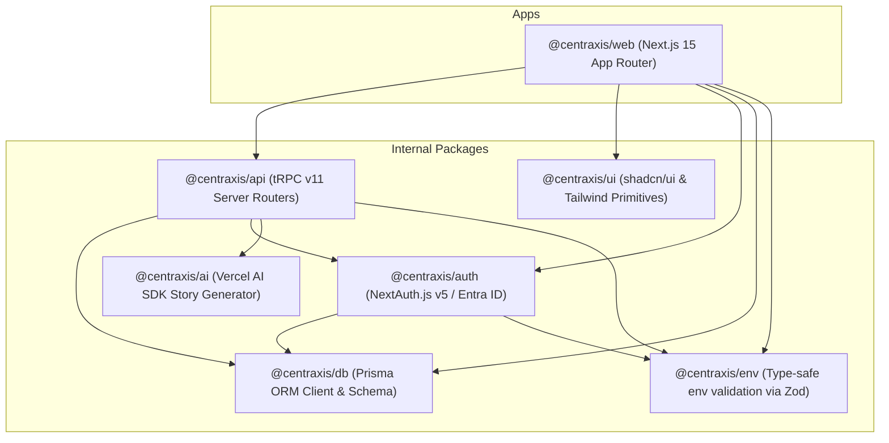
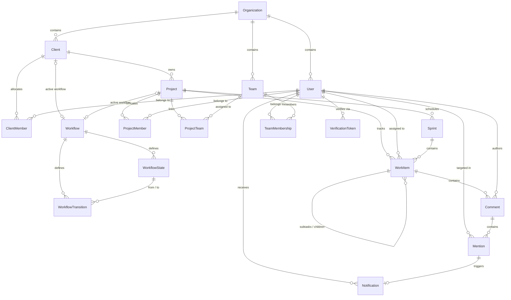

# Centraxis Architecture & Technical Specifications

This document outlines the architectural blueprint, data model, API contracts, and security enforcement mechanisms of **Centraxis**.

---

## 1. Monorepo Package Topology

Centraxis is built as a high-velocity monorepo managed by [Turborepo](https://turbo.build/) and [pnpm workspaces](https://pnpm.io/workspaces):



---

## 2. Directory Hierarchy (`apps/web/src/app`)

The application routes are structured using the Next.js App Router:

```text
apps/web/src/app/
├── (auth)/
│   ├── login/
│   │   └── page.tsx                  # Public login gateway
│   └── auth/
│       ├── signin/page.tsx           # Credentials & Entra ID signin form
│       └── verify-email/page.tsx     # 8-digit OTP verification gate for new users
│
├── (dashboard)/
│   ├── [clientSlug]/
│   │   ├── layout.tsx                # ClientLayout: validates slug, loads client, wraps ClientProvider
│   │   ├── page.tsx                  # ClientHomePage: client projects overview
│   │   ├── settings/
│   │   │   ├── page.tsx              # Client Settings: profile, domains, branding, members
│   │   │   └── workflows/
│   │   │       └── [workflowId]/
│   │   │           └── edit/page.tsx # Visual Client-Scoped Workflow Editor (React Flow)
│   │   └── [projectKey]/
│   │       ├── layout.tsx            # ProjectLayout: validates project, loads active sprint, wraps ProjectProvider
│   │       ├── board/
│   │       │   └── page.tsx          # Interactive Kanban board
│   │       ├── backlog/
│   │       │   └── page.tsx          # Sprint backlog planning & rank ordering
│   │       ├── teams/
│   │       │   └── page.tsx          # Squad allocations & cross-functional teams
│   │       ├── metrics/
│   │       │   └── page.tsx          # Sprint metrics & burndown analytics
│   │       └── settings/
│   │           └── workflow/page.tsx # Visual Project-Scoped Workflow Editor
│   │
│   ├── admin/
│   │   ├── page.tsx                  # Global SYSTEM_ADMIN tenant overview
│   │   └── workflows/
│   │       └── [workflowId]/
│   │           └── edit/page.tsx     # Visual Global Workflow Editor (React Flow)
│   │
│   └── settings/
│       ├── profile/page.tsx          # User profile settings
│       ├── clients/page.tsx          # Client tenancy management
│       └── members/page.tsx          # Organization members & access management
│
├── api/
│   ├── auth/[...nextauth]/route.ts   # NextAuth API route handlers
│   └── trpc/[trpc]/route.ts          # tRPC HTTP batch request handler
│
├── layout.tsx                        # Root layout: ThemeProvider, TRPCReactProvider, Toaster
├── page.tsx                          # Root redirect: auto-resolves user's default client workspace
└── middleware.ts                     # Next.js Route Guard Middleware (session & email verification checks)
```

---

## 3. Relational Schema & Entity Relationships

The data layer is managed with **Prisma ORM** connecting to **PostgreSQL 16**:



### Core Relational Models

- **`Organization`**: Multi-tenant top-level boundary (e.g. `Centvis`).
- **`Client`**: Client tenant space (e.g. `Client Apex`, slug `client-apex`). Unique by `[orgId, slug]`. Stores `allowedDomains` (`String[]`), optional Entra `tenantId`, and active `workflowId`.
- **`ClientMember`**: Explicit join table associating users with clients, assigning `ClientRole` (`CLIENT_ADMIN`, `CLIENT_MEMBER`).
- **`Project`**: Agile project space (e.g. `Centraxis Core`, key `CTX`) linked to a parent `Client` and optional project-level `workflowId`.
- **`ProjectMember`**: Explicit join table associating users with projects, assigning `ProjectRole` (`PROJECT_LEAD`, `MEMBER`, `VIEWER`).
- **`Workflow`**: State-machine definition with `scope` (`GLOBAL`, `CLIENT`, `PROJECT`), `isPublished` boolean, `version` integer, and associations to `Client` or `Project`.
- **`WorkflowState`**: Status node within a workflow with `name`, `slug`, `category` (`START`, `TODO`, `IN_PROGRESS`, `IN_REVIEW`, `DONE`), `color`, and `orderIndex`. Unique by `[workflowId, slug]`.
- **`WorkflowTransition`**: Directed edge between states with trigger `name`, optional `fromStateId` (`null` for "Any"), `toStateId`, and optional `requiredRole` (`PROJECT_LEAD`, `MEMBER`, `VIEWER`).
- **`VerificationToken`**: 8-digit OTP access token storing `identifier` (email), `token` (8-digit code), and `expires` timestamp (15-minute window).
- **`Team` / `Squad`**: Cross-functional team (Frontend, Backend, Platform) linked to projects via `ProjectTeam`.
- **`Sprint`**: Time-boxed sprint cycle with `SprintStatus` (`PLANNED`, `ACTIVE`, `COMPLETED`).
- **`WorkItem`**: Agile issue with `WorkItemType` (`EPIC`, `FEATURE`, `STORY`, `TASK`, `BUG`), `WorkItemStatus` (`BACKLOG`, `TODO`, `IN_PROGRESS`, `IN_REVIEW`, `DONE`), `stateSlug` matching active workflow state, `WorkItemPriority`, hierarchical self-relation (`parentId`), and fractional `rankOrder`.
- **`Comment`**: Discussion entry on a work item with rich Markdown body and relational authorship.
- **`Mention`**: Extracted `@mention` entity linking comments to specific mentioned users.
- **`Notification`**: In-app alert record with `NotificationType` (`MENTION`, `ASSIGNED`, `STATUS_CHANGED`), unread state (`isRead`), direct links, and optional relation to `Mention`.
- **`User`**: Identity model containing `globalRole` (`SYSTEM_ADMIN`, `USER`), `emailVerified` timestamp, `isTemporary` boolean for bootstrap administration, and membership associations across clients, projects, and squads.

---

## 4. tRPC v11 API Architecture

All client-server communications use type-safe [tRPC](https://trpc.io/) procedures:

### Router Inventory

| Router         | File                                       | Procedures                                                                                                                                 | Purpose                                                                            |
| :------------- | :----------------------------------------- | :----------------------------------------------------------------------------------------------------------------------------------------- | :--------------------------------------------------------------------------------- |
| `clients`      | `packages/api/src/routers/client.ts`       | `list`, `getBySlug`, `getById`, `create`, `update`                                                                                         | Client workspace resolution, allowed domains, and tenant mappings                  |
| `project`      | `packages/api/src/routers/project.ts`      | `list`, `getByClientAndKey`, `getAssignableUsers`, `create`                                                                                | Project metadata, cross-client resolution, and scoped assignee querying            |
| `workflow`     | `packages/api/src/routers/workflow.ts`     | `list`, `getWorkflowForEdit`, `upsertState`, `deleteState`, `createTransition`, `deleteTransition`, `publishWorkflow`, `getActiveWorkflow` | State-machine definition, Draft/Publish lifecycle, canvas nodes & edges            |
| `auth`         | `packages/api/src/routers/auth.ts`         | `sendVerificationCode`, `verifyEmailCode`, `getVerificationStatus`                                                                         | 8-digit OTP code dispatch, token verification, and email verification gating       |
| `workItem`     | `packages/api/src/routers/work-item.ts`    | `getSubTasks`, `createSubTask`, `updateSubTaskStatus`, `updateSubTask`, `deleteSubTask`                                                    | Sub-task lifecycle management, sequential keys, and roll-up metrics                |
| `comment`      | `packages/api/src/routers/comment.ts`      | `listByWorkItem`, `create`, `delete`                                                                                                       | Markdown comment feeds, scoped `@mention` parsing, and transactional notifications |
| `notification` | `packages/api/src/routers/notification.ts` | `getUnreadCount`, `listRecent`, `markAsRead`, `markAllAsRead`                                                                              | Header notification bell, unread counters, and notification feed                   |
| `board`        | `packages/api/src/routers/board.ts`        | `getBoardData`, `moveCard`                                                                                                                 | Active sprint Kanban board card fetching and workflow-validated transitions        |
| `backlog`      | `packages/api/src/routers/backlog.ts`      | `getTree`, `getItems`, `createItem`, `updateItem`, `reorder`                                                                               | Hierarchical backlog tree, sprint pools, quality gates, and status transitions     |
| `sprint`       | `packages/api/src/routers/sprint.ts`       | `list`, `getActive`, `create`, `start`, `complete`                                                                                         | Sprint lifecycle planning, active sprint resolution, and completion                |
| `org`          | `packages/api/src/routers/org.ts`          | `getDetails`, `listMembers`, `updateUserAccess`                                                                                            | Global organization management, user role matrices, and invitations                |
| `ai`           | `packages/api/src/routers/ai.ts`           | `generateStory`, `listLogs`                                                                                                                | AI INVEST story drafting powered by Vercel AI SDK                                  |
| `metrics`      | `packages/api/src/routers/metrics.ts`      | `getSprintMetrics`, `getVelocity`                                                                                                          | Burndown chart data points and velocity analytics                                  |

---

## 5. Security & Authorization Pipeline

### A. Route Guard Middleware (`apps/web/src/middleware.ts`)

- Runs on Edge runtime before page render.
- Validates the presence of session tokens in cookies (`authjs.session-token` / `next-auth.session-token`).
- Automatically intercepts unauthenticated requests and redirects to `/login?callbackUrl=...`.
- Intercepts authenticated users whose `emailVerified` is null/empty and routes them to `/auth/verify-email`.
- Bypasses static assets, `_next/*`, `favicon.ico`, and `/api/*` endpoints.

### B. Client & Project Layout Guards

- `[clientSlug]/layout.tsx`: Invokes `api.clients.getBySlug({ slug: clientSlug })`. If the client does not exist or the non-admin user is not a member of the client, it returns an "Access Denied / Not Found" error card.
- `[clientSlug]/[projectKey]/layout.tsx`: Invokes `api.project.getByClientAndKey({ clientSlug, projectKey })`. Validates that the project key strictly belongs to the requested client slug. Mismatched projects return a 404 "Project Not Found" block.

### C. tRPC Procedure Authentication

Procedures are protected using contextual middleware in `packages/api/src/trpc.ts`:

- `publicProcedure`: Unrestricted access.
- `protectedProcedure`: Enforces that `ctx.session.user` is present.
- `adminProcedure`: Enforces that `ctx.session.user.globalRole === "SYSTEM_ADMIN"` or `role === "ORG_ADMIN"`.
- `scrumMasterProcedure`: Enforces Scrum Master, Lead, or Admin privileges.

### D. Assignee Scoping Validation

When creating or modifying an issue (`backlog.createItem` / `backlog.updateItem` / `workItem.createSubTask`):

- The server checks whether `assigneeId` is associated with the project's parent `clientId` or `projectId`.
- If an unassociated user ID is submitted, the mutation throws:
  ```ts
  throw new TRPCError({
    code: "BAD_REQUEST",
    message:
      "Selected user is not a member of this project or client workspace.",
  });
  ```

### E. Sub-Task Quality Gate Enforcement

When marking any parent work item status as `DONE` or `RESOLVED` (`backlog.updateItem`):

- The server queries child sub-tasks linked via `parentId`.
- If any child item is not in status `DONE`, the mutation rejects the transition:
  ```ts
  throw new TRPCError({
    code: "PRECONDITION_FAILED",
    message:
      "Cannot resolve work item while child sub-tasks are incomplete. Please complete all sub-tasks first.",
  });
  ```

### F. Scoped @Mention Authorization

When parsing comments for `@mention` tags (`comment.create`):

- Mentions are parsed using structured syntax `@[Name](userId)` and `@username`.
- Target users are strictly validated against project and client memberships. Cross-tenant users cannot be notified.
- Transactional `Notification` rows are created exclusively for authorized scoped users. Self-mentions are ignored.

### G. Cold-Start Bootstrap Administration Security

- Cold-start initial environments read `BOOTSTRAP_ADMIN_USERNAME` and `BOOTSTRAP_ADMIN_PASSWORD` from `.env`.
- An initial `SYSTEM_ADMIN` user is provisioned with `isTemporary: true`.
- Sessions for temporary users reflect `isTemporary: true`, alerting UI consumers to display visible temporary warnings.

### H. Workflow State Transition Validation

When moving cards across the Kanban board (`board.moveCard`) or updating status via the drawer (`backlog.updateItem`):

- The server resolves the active workflow scheme using hierarchical fallback: `Project.workflowId` $\rightarrow$ `Client.workflowId` $\rightarrow$ `Global Default Workflow`.
- Resolves the source state and destination state by `stateSlug` / ID.
- Verifies that an explicit directed transition exists between source and destination (or an "Any" state transition where `fromStateId === null`).
- If a `requiredRole` is configured on the transition, the server verifies the user's role in the active project (`PROJECT_LEAD`, `MEMBER`, etc.).
- If the transition is prohibited or the user lacks the required role, the mutation aborts with `BAD_REQUEST`:
  ```ts
  throw new TRPCError({
    code: "BAD_REQUEST",
    message: "Invalid status transition for the active workflow.",
  });
  ```

---

## 6. Design Tokens & Styling Architecture

The design system standardizes on [ui.shadcn.com](https://ui.shadcn.com/) with solid opaque tokens defined in `packages/ui/src/styles/globals.css`:

```css
:root {
  --background: 0 0% 100%;
  --foreground: 224 71.4% 4.1%;
  --card: 0 0% 100%;
  --card-foreground: 224 71.4% 4.1%;
  --popover: 0 0% 100%;
  --popover-foreground: 224 71.4% 4.1%;
  --primary: 245 82% 62%; /* Centvis Electric Indigo */
  --primary-foreground: 210 40% 98%;
  --border: 220 13% 91%;
  --input: 220 13% 91%;
  --ring: 245 82% 62%;
  --radius: 0.5rem;
}

.dark {
  --background: 224 71% 4%; /* Deep Slate Neutral */
  --foreground: 210 40% 98%;
  --card: 224 71% 6%;
  --card-foreground: 210 40% 98%;
  --popover: 224 71% 5%;
  --popover-foreground: 210 40% 98%;
  --border: 215 27.9% 16.9%;
  --input: 215 27.9% 16.9%;
}
```

This guarantees high contrast and non-transparent backgrounds across all dropdown menus, selects, sheets, and popovers.
